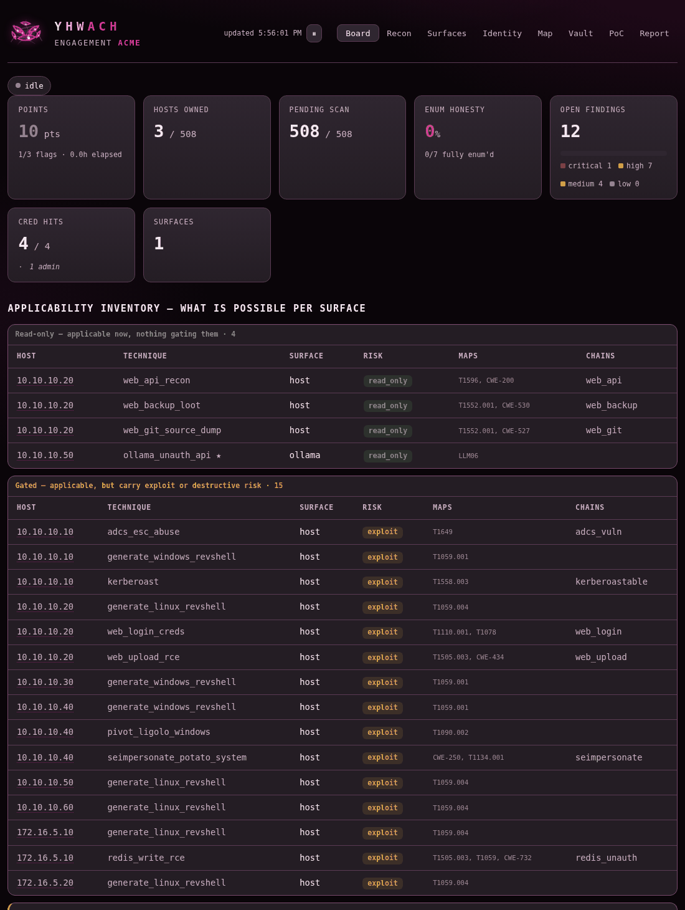
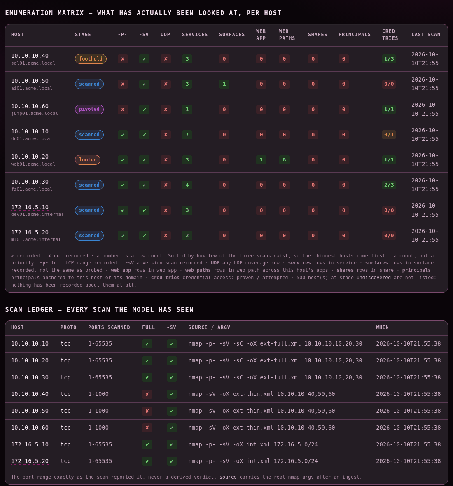
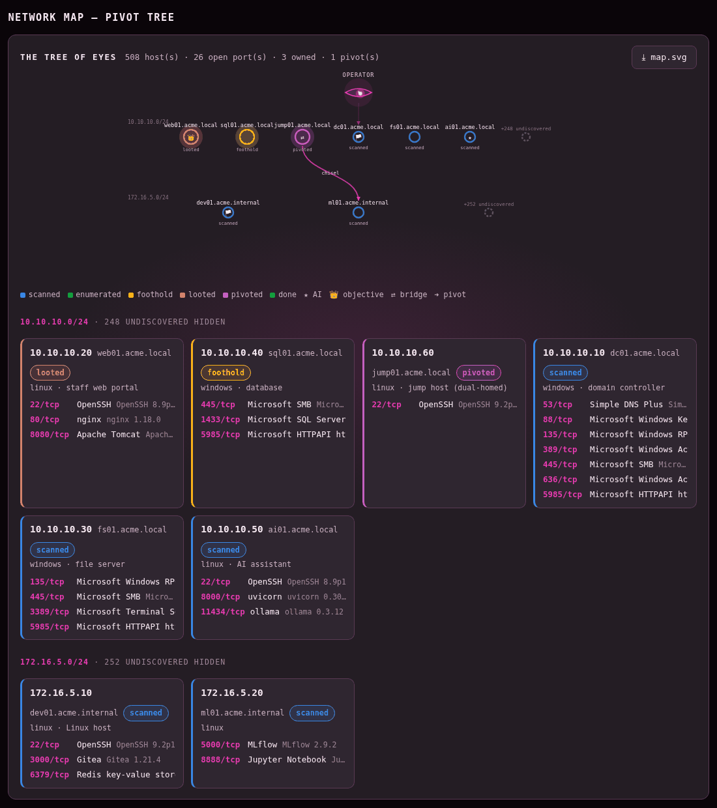
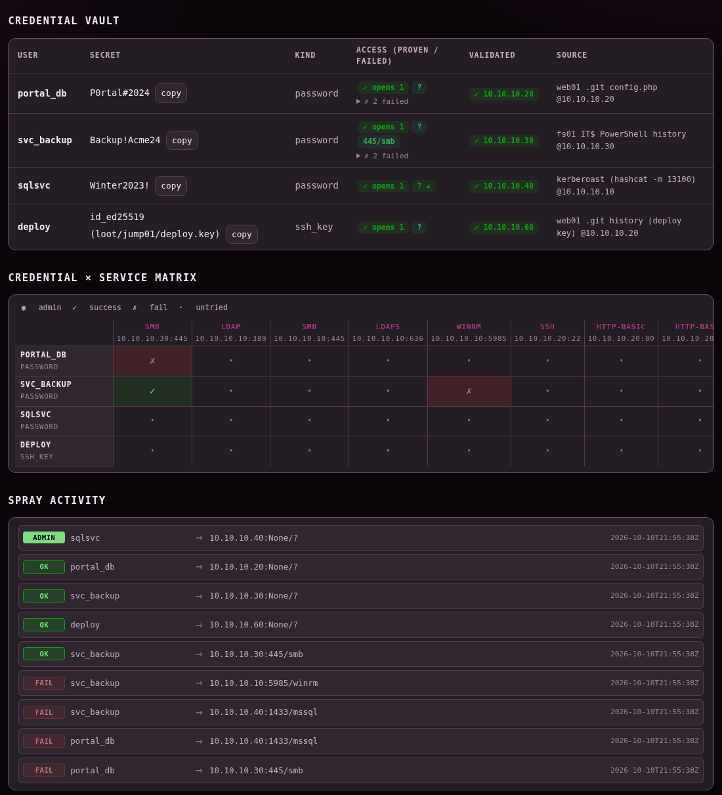
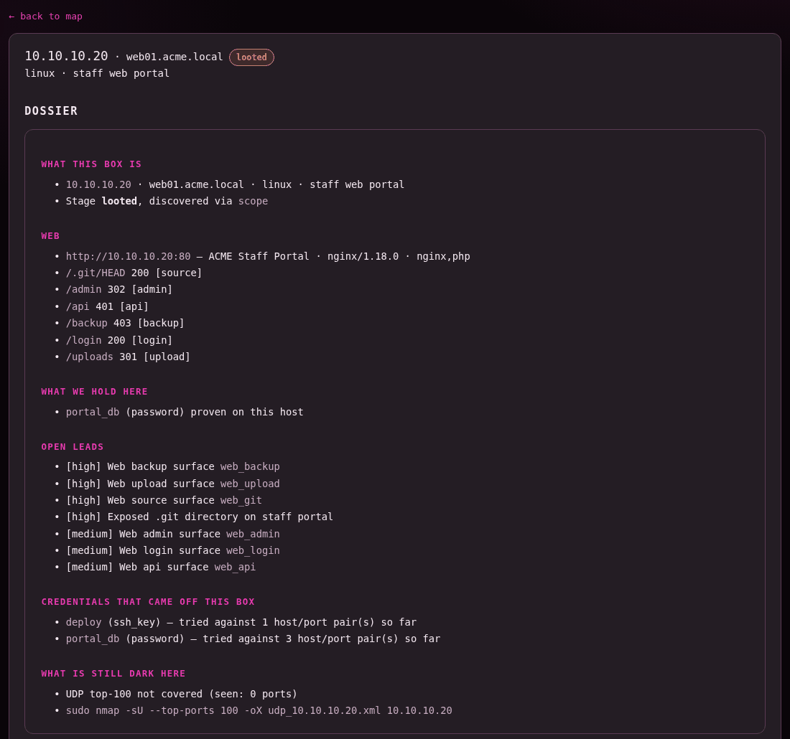

<p align="center">
  
</p>

**A memory and playbook for AI-assisted penetration testing: it remembers everything you've found, so you and your agent don't have to.**

A real engagement is long and messy: hundreds of IP addresses, dozens of credentials, several subnets behind pivots, findings that only matter three hosts later. Chat context runs out, notes drift, and the thing that loses you the engagement is rarely a missing exploit — it's forgetting what you already found and what you never checked.

Yhwach is the **memory** for that work. It keeps the whole engagement as **structured data in SQLite** — every host, service, surface, credential, finding, pivot and objective is a typed row — and hands it back to you and your AI agent on demand: what you can reach, what you hold, what is still unexplored, which techniques apply right now, and where the shortest path to your objective runs.

> Named after Yhwach, who sees every possible future. This shows you every option — you pick one.

---

## ⚠️ Read this first — yhwach is not an autonomous pentester

> [!IMPORTANT]
> **Yhwach remembers. It does not plan your attack, and it does not update itself.**
>
> - It **never calls an AI model** and never runs on a schedule. Your MCP client (Claude Code / Codex CLI) is the brain, and **you are in charge of the attack path**.
> - It **knows only what it was told**: tool output you ingested and facts you (or your agent, at your request) recorded. It does not watch your network, your terminal, your files or your notes.
> - **Agent instructions are not enough to keep it current.** Nothing forces an agent to record every new host, credential or finding. If you don't feed yhwach, its picture of the engagement goes stale — and a stale map is worse than none.
> - **Maintaining the memory is part of the job.** You update it regularly, through the whole engagement, the same way you'd keep a lab notebook.
> - **One exception — recording can generate traffic.** Recording a credential (`yhwach_add_cred`) immediately tries it against every matching service already in memory, and an nmap ingest or `yhwach_scan` tries every stored credential against newly found services (via NetExec / curl). Know the lockout policy before you record passwords — see [Before you rely on it](#before-you-rely-on-it).
>
> This is a different way of working with a pentest tool: **the human drives, the agent executes and records, yhwach remembers.** Used that way, it keeps a long, complicated engagement coherent. Used as a fire-and-forget robot, it won't work.

---

## How it works

| Who | Role |
|---|---|
| **You (human)** | Own the engagement. Choose the attack path, approve every exploit, decide what is worth recording, keep the memory and the notes current. |
| **Your agent** (Claude Code / Codex CLI) | Runs the tools you ask for, reads yhwach's map before suggesting a move, and records results into yhwach when you tell it to. |
| **yhwach** (MCP server) | The memory and the playbook. Stores every fact as a typed row, then answers: *what do we have, what's left, what applies next, how do we get there.* |

Inside yhwach:

- **Memory** — a SQLite database plus parsers that turn saved tool output into typed facts: nmap, linPEAS / winPEAS, NetExec, BloodHound (SharpHound JSON), certipy and web content discovery.
- **Knowledge** — a **recall menu** of ~170 playbook technique rules (`playbooks/*.yaml`) that lists *every* technique matching the current state of a host, so the model picks from a complete menu instead of remembering one. Chaining (a finding unlocking the next technique) and safety tiers (read-only vs. gated) are deterministic, never left to the model.
- **Offline references** — `yhwach_ref` packs: **curated offline subsets** of default creds, AD CS ESC1–16, GTFOBins, LOLBAS and WADComs, plus lessons, the service matrix, the chaining-tag registry, AI-attack chains (OWASP-LLM / ATLAS-mapped) and a tooling index (`yhwach_ref arsenal`). Plus an offline version→CVE map (`yhwach_vulns`). These are subsets — **a miss is not proof that no abuse or CVE exists.**
- **Completeness checks** — `yhwach_gaps` / `yhwach_coverage` name every host that was never fully port-scanned, version-scanned or UDP-swept, and every probed surface of a known service kind that has no finding or attempt yet. Run `yhwach_probe` on a host first so its surfaces are known.

---

## Requirements

- **Python 3.11+** and `git`. **SQLite** comes with Python — nothing to install.
- **An MCP client**: [Claude Code](https://docs.claude.com/en/docs/claude-code) or [Codex CLI](https://github.com/openai/codex). **Yhwach itself needs no API key.**
- **Your usual toolset on `PATH`** (Kali works well): nmap, NetExec, impacket, BloodHound / SharpHound, certipy, … Yhwach records and recalls; it does not replace these tools, and it **ships no offensive binaries** — [`arsenal.manifest.yaml`](arsenal.manifest.yaml) only names and links the tools its playbooks mention, so you can fetch and vet them yourself.
- *Optional:* [HexStrike](https://github.com/0x4m4/hexstrike-ai) bound to loopback, as a delegated enumeration backend.

---

## Install & register as an MCP server

```bash
git clone https://github.com/saymyname-sec/yhwach ~/yhwach && cd ~/yhwach
python3 -m venv .venv && . .venv/bin/activate
pip install -e ".[mcp,ui]"                      # mcp = the server; ui = the board (recommended — see below)
mkdir -p "$HOME/.local/share/yhwach/state"      # the DB directory (your first engage would also create it)
yhwach doctor                                   # preflight check
```

`yhwach doctor` also prints lines about the optional `[mcp]`/`[ui]` extras and HexStrike reachability — install what you need and ignore the rest. It needs no API key.

Yhwach keeps its database under one workspace: `$YHWACH_HOME`, else `$XDG_DATA_HOME/yhwach`, else `~/.local/share/yhwach` (`$YHWACH_DB` points at a DB file directly). One workspace can hold many engagements — each has its own **lab name**.

**Claude Code** — register once, at **user scope** (so the tools exist in every folder you start Claude Code from, not just this one). Use the absolute path to the venv binary so it works even when the venv isn't activated:

```bash
claude mcp add -s user yhwach -e YHWACH_HOME="$HOME/.local/share/yhwach" -- "$HOME/yhwach/.venv/bin/yhwach" mcp
claude mcp list      # yhwach should show as connected (or run /mcp inside Claude Code)
```

**Codex CLI** — register with the CLI:

```bash
codex mcp add yhwach --env YHWACH_HOME="$HOME/.local/share/yhwach" -- "$HOME/yhwach/.venv/bin/yhwach" mcp
```

…or add it to `~/.codex/config.toml` by hand (TOML does not expand `~` or `$HOME` — **replace `/home/you` with your home directory**):

```toml
[mcp_servers.yhwach]
command = "/home/you/yhwach/.venv/bin/yhwach"
args = ["mcp"]
env = { YHWACH_HOME = "/home/you/.local/share/yhwach" }
```

So that the terminal reads the **same database** as the MCP server, put the same workspace in your shell profile:

```bash
echo 'export YHWACH_HOME="$HOME/.local/share/yhwach"' >> ~/.zshrc     # or ~/.bashrc
```

That exposes the full `yhwach_*` toolset to your agent (run `yhwach schema` to list every one):

| Purpose | Tools |
|---|---|
| **Feed the memory** | `engage` · `ingest`† · `add_cred`† · `add_finding` · `add_loot` · `set_host` · `add_interface` · `tag` / `untag` · `advance` · `pivot` · `objective` · `poc_step` · `annotate` |
| **Ask the memory** | `status` · `brief` · `next` · `gaps` · `coverage` · `paths` / `path` · `dossier` · `recon` · `findings` · `creds` · `audit` · `ref` · `vulns` · `derive` |
| **Active — sends traffic to targets** | `scan`† · `enum` · `probe` · `spray` |
| **Write-ups** | `poc` · `report` · `export_notes` |

*(each prefixed `yhwach_`, e.g. `yhwach_brief`)*

† **also tries credentials against live services** — `add_cred` sprays the new credential; an nmap `ingest` and `scan` spray stored credentials at newly found services. `vulns` (offline CVE match) and `derive` (candidate passwords) never touch a target.

### What sends traffic, and when

Most of yhwach is a local memory you read and write — it sends nothing. Only a few actions reach a target, and even those are gated:

| Action | Traffic to a target? | When |
|---|---|---|
| `status` · `brief` · `next` · `gaps` · `paths` · `dossier` · `recon` · `findings` · `creds` · `audit` · `ref` · `vulns` · `query` | **No** | pure reads over the local DB |
| `ingest` / `interpret` (paste tool output), `add_finding`, `tag`, notes | **No** | parse/record text you already have |
| `enum` · `probe` · `spray` · `scan` | **Yes** | active scanning and real authentication attempts |
| `add_cred` | **Yes** | immediately sprays the new credential at every matching service already in memory |
| nmap `ingest` / `scan` | **Yes** | re-tests stored credentials against newly discovered services |

And the gates that sit in front of every traffic-sending action:

- **Record-only by default.** Outside `lab`/`ctf` engagements, scan/enum/probe/spray are refused until a human runs **`yhwach arm`** in a terminal — arming is never an MCP argument, so the model can ask for it but cannot do it.
- **Dumped hashes and cracked passwords never auto-spray.** They are `manual`; only a credential you name explicitly is ever sprayed.
- **Scope is a chokepoint.** An empty scope refuses everything; exclusions win over inclusions.
- **`YHWACH_AUTOSPRAY=0`** is a hard kill switch that disables every active path.

`yhwach doctor --lab <name>` prints the current traffic state (armed? in scope?) in one line.

Most read commands also work in a plain terminal, with no model involved — every one needs `--lab`:

```bash
yhwach status  --lab acme
yhwach brief   --lab acme --section unexplored
yhwach next    --lab acme --host 10.10.10.5
yhwach gaps    --lab acme
yhwach paths   --lab acme
yhwach recon   --lab acme --host 10.10.10.5
yhwach report  --lab acme --out report.md
```

Run `yhwach --help` for the full list.

---

## The methodology — working a long engagement with yhwach

This is the core of using yhwach. Think of it as a loop you repeat for the whole engagement — **you** steer it, the agent does the typing, yhwach holds the state.

### 0. Tell your agent the routine

Agent instructions alone won't keep the memory current (see above) — but without them, the agent won't even try. Put something like this in your project's `CLAUDE.md` (Claude Code) or `AGENTS.md` (Codex), and adjust it:

```markdown
## yhwach — engagement memory
- Lab: `acme`. Scope: 10.10.10.0/24. Pass `lab: acme` to every yhwach_* call.
- Start every session with `yhwach_status`, then the `yhwach_brief` sections you need
  and `yhwach_next` for the host you're on. Then read `notes/acme/resume.md`.
- Save every tool's output to a file, then `yhwach_ingest` that file (nmap: `-oX`).
- After any credential, finding, stage change, pivot or flag: record it in yhwach AND
  update the matching note in the same step. Never "later".
- Never re-run an approach listed in `exhausted-approaches.md` without asking me.
- Write each step into `notes/acme/chains/<ID>-<host>-<technique>.md` right after
  running it (template: docs/templates/chain-note.md).
- At every capture point run `docs/hooks/yhwach-shot.sh -l acme -n <ID>-<step> --cmd -- <command>`
  and paste the EMBED line it prints. If it prints SCREENSHOT-MISSING, write that token.
- yhwach recalls options; I choose the attack path. Ask before any exploit.
- Before `yhwach_add_cred`, check the lockout policy — recording a credential sprays it.
```

The habit still has to come from you: check that it happened — and keep [the board](#the-board--how-you-drive) open so you can see at a glance whether it did.

### 1. Open the engagement

Give it a lab name and the scope you're authorised for:

> *"Engage lab `acme` on 10.10.10.0/24, domain corp.local, DC 10.10.10.10."*

`yhwach_engage` creates the engagement and adds every in-scope address as an *undiscovered* host, so nothing in scope can be forgotten. Ranges larger than a **/20** are not expanded (engage reports them as skipped) — split them into /20s or smaller, or their hosts only appear once a scan finds them.

### 2. Feed every result — the same moment you get it

After **every** scan or tool run, have the agent ingest the output. What isn't ingested doesn't exist for yhwach.

> *"Ingest that nmap XML into yhwach and tell me what changed."*
>
> *"Ingest the linPEAS output for 10.10.10.5."*

`yhwach_ingest` reads a **saved file**, not pasted text. It creates hosts and services, records how thoroughly each host was scanned, and tags findings so the recall menu can chain them. Every kind except nmap needs the host already in memory (scan it first) and a `host`:

| Tool | What to save and feed |
|---|---|
| **nmap** | `-oX` (best) or `-oN` output file — no host needed, it creates hosts |
| **linPEAS / winPEAS** | the saved stdout + the host it ran on |
| **NetExec** | the saved stdout + the target host |
| **BloodHound** | **unzip** the SharpHound zip and ingest `users_*.json` and `computers_*.json` one at a time, host = the DC |
| **certipy** | output of `certipy find -vulnerable -json`, host = the CA or DC |
| **Web discovery** | gobuster / ffuf / feroxbuster / dirb output, host + the base URL it ran against |
| **Anything else** | no parser over MCP — record it with `yhwach_add_finding` / `yhwach_add_loot`. In a terminal, `yhwach ingest --lab acme --kind raw --title "<title>" --host <ip> <file>` stores it as a finding and keeps the full output as loot |

### 3. Record what no parser can see

Parsers don't read your mind. These you (or the agent, on your word) record explicitly:

| What happened | Record it with |
|---|---|
| Found / cracked a credential | `yhwach_add_cred` — include **where it was found** and **where it works** (`validated_on`). ⚠️ This immediately tries it against matching services. |
| Confirmed a vulnerability or lead | `yhwach_add_finding` — give it a **chaining tag** (see `yhwach_ref tags`) so it shows in the brief and unlocks follow-on techniques |
| Grabbed a file, key or dump | `yhwach_add_loot` (a secret inside it still needs `add_cred`) |
| Learned a hostname / OS / role, or a second NIC | `yhwach_set_host` · `yhwach_add_interface` |
| Got a foothold, looted, finished a host | `yhwach_advance` with a one-line *why* |
| Pivoted into a new subnet | `yhwach_pivot`, **then re-run `yhwach_engage` with the FULL scope** — every earlier range plus the new one, e.g. *"Re-engage lab acme with scope 10.10.10.0/24,172.16.5.0/24"*. Engage **replaces** the scope: anything you leave out is treated as out of scope from then on. |
| Captured a flag / objective | `yhwach_objective` (the proof itself lives in your notes and PoC chain) |
| Did something reproducible | `yhwach_poc_step` — the exact command, its output, any script used |
| Tried something that **didn't** work | `yhwach_annotate` on the host, **one section per approach** (re-annotating a section replaces it) + your *exhausted approaches* note — the note is the durable record |

### 4. Ask before you decide

Before picking the next move, ask yhwach — then **you** choose:

> *"Brief me. What's still unexplored, and what does `next` suggest for 10.10.10.5?"*

| Ask | You get |
|---|---|
| `yhwach_status` | Compact counts — the cheap way to re-orient |
| `yhwach_brief` | The engagement map: what you can **reach**, what you **hold**, live **surfaces**, what's **gated** behind a credential, the **unexplored** frontier, **objectives** — whole, or one section at a time |
| `yhwach_next` | The recall menu: every technique that applies right now, per host, split read-only vs. gated, plus enumeration gaps and untried credentials |
| `yhwach_gaps` / `yhwach_coverage` | Hosts and probed services that were never fully enumerated — and the exact scan that closes each gap |
| `yhwach_paths` | Shortest path from everything you own to each objective and to Domain Admins |
| `yhwach_dossier` / `yhwach_recon` | Everything known about one host |

Yhwach recalls and ranks options; it never decides. The attack path is yours.

### 5. Drive from the board — when the agent runs dry, you bring the ideas

This is the part people miss, and it's where yhwach earns its keep. Your agent will run out of ideas on a host long before the host is actually exhausted. **You** don't have to hold the whole estate in your head to see what it skipped — [the board](#the-board--how-you-drive) does. Keep it open in a browser the whole engagement:

- **At the start of a host, and whenever the agent stalls, read the board yourself.** The *Recon* page shows, per host, which scans were run and which weren't; *Surfaces* lists every port, service, version and web path; *Map* shows what's reachable and what's still dark. You're looking for the thing nobody thought to check: a UDP sweep never run, an 8080 nobody touched, a share never listed, a vhost never fuzzed.
- **Then feed that back as a concrete instruction.** The flow is usually *you* spotting something on the board and telling the agent to go look: *"The board shows 10.10.10.40 has 1433 open but no SQL enumeration — go at it,"* or *"ai01 has an ollama surface that was never triaged — probe it."* Yhwach remembers; you supply the curiosity.
- **Completeness is something you confirm on the board, not something you assume.** Before you call a host done, the *Recon* matrix and the coverage panel should show every path checked. A green row is a checked box; a gap is an open door. (`yhwach_gaps` says the same thing in text — the board just lets you see it all at once.)
- **The board never touches a target.** It's a read-only window; every action still runs through you and your agent.

### 6. Resume after a break or a context reset

Your chat context will be reset or compacted many times. The memory isn't:

> *"Check yhwach status for lab `acme`, show me the unexplored and objectives sections of the brief, then read my resume note and tell me where we are."*

Start every session with `yhwach_status`, then the `brief` sections you need (`objectives`, `unexplored`, `hold`) and `yhwach_next` for the host you're working, plus `resume.md` in your Obsidian vault (below). A full `brief` or a host-less `next` on a big scope is long — ask for slices.

### Working at scale — many hosts, credentials and subnets

- **Let yhwach hold the lists.** Don't paste hundreds of IPs into chat — ask for slices: one host's `next` / `dossier` / `gaps`, or one `brief` section (`reach`, `hold`, `surfaces`, `unlocks`, `unexplored`, `objectives`).
- **Every new subnet is a new scope.** Record the pivot, re-engage with the **full** scope (old ranges + the new one), then scan and ingest the new segment like a fresh engagement.
- **Credentials are never "used up."** Each one stays in yhwach's credential store and stays relevant for every new host. Record where it works (`validated_on`); failed attempts are logged by the sprays (`yhwach_spray` and the automatic ones).
- **Keep names stable.** One lab name per engagement; set hostnames and roles once so maps and briefs stay readable.

### Keeping the memory honest

At the end of each working session, run through this checklist with your agent:

- [ ] Every scan and tool output from this session is ingested.
- [ ] Every new credential is recorded, with where it works.
- [ ] Every confirmed finding is recorded with a chaining tag.
- [ ] Host stages are advanced (foothold / looted / pivoted / done).
- [ ] Pivots are recorded and the scope re-engaged in full.
- [ ] Failed approaches are noted, so they aren't retried blindly.
- [ ] `yhwach_brief` matches what you believe is true — if it doesn't, fix the memory now (below).
- [ ] Your Obsidian notes are updated (next section).

**Correcting the memory.** Wrong facts will happen in a long engagement. Re-recording the same credential (same identifier and kind) or the same finding (same host, class and title) **updates** it rather than duplicating it. A wrong stage: `yhwach advance --lab acme --host 10.10.10.5 --to <stage> --force --why "<reason>"` in a terminal (the MCP tool won't move a stage backwards). A wrong tag: `yhwach_untag`. Credentials and findings can't be deleted, so for anything else that's wrong or stale, record the correction with `yhwach_annotate` on the host — and fix the note.

*Optional helper:* [`docs/hooks/yhwach-sync-reminder.sh`](docs/hooks/yhwach-sync-reminder.sh) is a Claude Code `PostToolUse` hook that interrupts your agent after offensive commands (NetExec, impacket, certipy, evil-winrm, `ssh user@…`, …) to remind it to record the result. It needs `jq`, the install steps are in the script header, and it's Claude Code only. It's a nudge — it records nothing, and it does not fire after plain nmap or web scans.

### Before you rely on it

> [!WARNING]
> - **Recording can send traffic.** `yhwach_add_cred` immediately tries the new credential against every matching service already in the memory, and an nmap ingest or `yhwach_scan` re-tests stored credentials against new services — real authentication attempts. Know the lockout policy before recording passwords, and stay within your authorised scope.
> - **You enforce the scope.** The active tools (`scan`, `enum`, `probe`, `spray`) act on whatever you point them at.
> - **Secrets are stored and shown in clear** — to the model (`yhwach_creds`) and on the board. The board's `--redact` masks only part of it (see [The board](#the-board--how-you-drive)).

---

## The board — how you drive

**Run the board. It's not a dashboard you glance at — it's how you steer the engagement.** Your agent works one host at a time through a narrow window; the board is where *you* see the whole estate at once and spot what it skipped. Keep it open the whole time.

```bash
yhwach ui --lab acme --redact      # http://127.0.0.1:8799 — read-only, binds to localhost
```

Eight pages, each answering one question. The screenshots below are a small fictional engagement (`acme`).

### Board — *where do I stand, and what's possible right now?*

The landing page. Scored tiles at the top (points, hosts owned, pending scans, enum honesty, findings), then the **applicability inventory**: every technique that applies to the current state, split read-only vs. gated — the same recall menu as `yhwach_next`, across the whole estate. Below it, the coverage panel (*what you still owe*, with the exact scan to close each gap) and the hosts-by-stage columns.



### Recon — *what has actually been looked at, per host?*

The completeness check. One row per host; columns for full-port, version scan, UDP, services, surfaces, web paths, shares, principals, credential tries. A ✓ is a checked box, an ✗ is an open door. Thinnest hosts sort to the top. The scan ledger below shows the exact `nmap` argv behind every row. **This is the page you read before calling a host done** — and the one that shows you the port nobody enumerated.



### Surfaces — *what's listening, and how much do we know about it?*

Every service, version and web path in one inventory, plus a decoded view of AI surfaces (models, tools, endpoints a probe found) and a payloads-sent/answered log. This is where you browse ports and protocols looking for the next lead to hand the agent.

### Identity — *what do we know about the AD, and what haven't we collected?*

Password policy (and a loud warning when the lockout policy is unknown — spraying blind can lock out the estate), the principal roster, rights per principal, shares, and an "AD world model" panel that names what has **not** been collected yet, so an empty Groups panel never reads as "the domain is flat".

### Map — *what can I reach, and what's still dark?*

The pivot tree: every host as a node coloured by stage, tunnels drawn as edges, and per-subnet rollups (discovered / owned / open ports / pending / undiscovered). A subnet behind a tunnel with nothing discovered inside shows as reachable-but-empty — a whole segment waiting to be scanned. Click any node for its host page.



### Vault — *which credentials open what, and where haven't they been tried?*

The credential vault (secret, what it opens, where it's validated, provenance), then the **credential × service matrix**: every credential is a row, every reachable service a column, each cell green (works / admin), red (failed) or grey (never tried). The grey cells are the question *"have my creds been tried everywhere they could be?"* — answered at a glance.



### PoC — *can I prove what I captured?*

Every objective and whether it has a reproducible chain behind it — including captured flags with **zero** recorded steps, the case that quietly loses points. Expand one to see its steps.

### Report — *what can the write-up not yet support?*

An evidence gap list (findings with no evidence line, captures with no chain, loot recorded but not saved locally), then the engagement-state summary and the full Markdown report, with both report files as downloads.

### The host page

Click a node on the map for one host's full picture: a dossier (*what this box is · what we hold here · open leads · what's still dark*), stage history, open ports, findings and every attempt run against it.



> [!WARNING]
> `--redact` masks secrets in the credential vault and withholds finding evidence, host dossiers and notes. It does **not** redact the **PoC** page or the **full-report download** — those still show stored secrets. The board binds to localhost; don't expose it or screen-share those two pages.

---

## Notes with Obsidian

Yhwach holds the **facts**. Your Obsidian vault holds the **story and the evidence**: how you got in, why it worked, and the proof. **The report is written from the vault, not from yhwach.**

> [!NOTE]
> **Yhwach never reads your Obsidian vault, and nothing syncs the two automatically.** Your agent writes notes with its normal file tools — when you ask it to. Record the fact in yhwach and write the note in the same step, every time.

The advice below comes from reviewing the vaults of real, finished engagements: a handful of notes carried the entire report, while others were created at kickoff and never filled. Put your effort where it pays. One folder per engagement, e.g. `~/notes/acme/`.

### Report notes — these become the report

| Note | Holds |
|---|---|
| `chains/<ID>-<host>-<technique>.md` | **One per flag / objective — the deliverable.** Seven fixed sections ([below](#the-chain-note)): every command, its output and a screenshot, start to flag. |
| `screenshots/` | Proof images, each paired with a `.txt` of the same command's output — made by [`docs/hooks/yhwach-shot.sh`](docs/hooks/yhwach-shot.sh) and embedded in the chain notes. |
| `credentials.md` | A **master table at the top**: principal · secret · where it works · how it was obtained (link the chain) · last verified · durable or ephemeral. Move superseded values to a section at the bottom instead of correcting them in prose further down. |
| `attack-chain.md` | The narrative: one dated phase per step forward, each linking its chain note. It becomes the report's summary. |
| `scripts/` | Every exploit or helper you ran, with a header: what it does, where it came from, what you changed, how you ran it. Feeds *Source & modifications*. |
| `loot/` | Small text loot (keys, configs) and an `.ORIGINAL` copy of every file you overwrite on a target, for cleanup. Large dumps stay outside the vault, referenced by path and hash. |
| `index.md` | The status board while you work. At the end, the **submission summary**: one row per flag with its chain link and its proof **embedded** (a plain filename renders nothing). |

### Working notes — keep you oriented, stay out of the report

| Note | Holds |
|---|---|
| `resume.md` | **One** rolling note, **overwritten** each session: where you are, how to reconnect, which access is durable (credentials, keys) and which is ephemeral (shells, tunnels, sessions), the next three moves, cleanup owed. Read it first after any break. |
| `next-steps.md` | Open leads, ranked. What's left at the end becomes the report's *not captured* section. |
| `exhausted-approaches.md` | Each dead end: what you tried, the result, **how confident** you are and **what you assumed** (tunnel up, fresh token, right credentials) — so it gets re-tested when that changes. Move an entry out when it turns out to work. |
| `hosts/<host>.md` | One per host you touch, under **one** canonical name. Keep its status lines (access, privesc, loot, link to its chain) **updated in place**, not as appended session logs, and update it after exploitation, not only at recon. |
| `network-map.md` | Subnets, routes, pivots and tunnels — and which of them die on a revert. |

### Skip these — they ended up empty

- **A new resume note every session.** They pile up and contradict each other. Keep one `resume.md`; archive old versions to `sessions/<date>.md`.
- **An `overview.md` written at kickoff.** Nobody updates it. Keep the summary in `index.md`, or write the overview at the end.
- **A half-used `findings/` folder.** Either one note per vulnerability (severity, evidence embed, link to its chain), or let section 2 of each chain note be the finding. Half-done leaves orphans.
- **`yhwach export-notes` inventory notes** (*Services & Software*, *Shares*, *Users & Groups*, *Vulnerabilities*, *Web*). They are built only from structured records yhwach holds, and in practice they stayed empty. Export them (into their own `_yhwach/` folder — each run overwrites it) only if you feed those records, and re-export after each ingest.
- **Non-chain notes in `chains/`** — resume points, deferred plans, idea lists. `chains/` holds exactly the deliverable.
- **Tool artifacts** — C2 session stubs, cracking session files, temporary run scripts. Keep them out of the vault.

### The chain note

Start every chain from [`docs/templates/chain-note.md`](docs/templates/chain-note.md) (it works with Obsidian's *Templates* plugin). Seven sections, in this order:

1. **Target + objective** — host, service, the proof file, points.
2. **Vulnerability** — class / CVE / misconfiguration in a sentence or two. This *is* the finding.
3. **Prerequisites** — exactly what a reader needs to start: tunnel, credentials (each linked to the chain that produced it), tools. Nothing else assumed.
4. **Steps** — numbered. Each one: the exact command, the verbatim output from its `.txt`, one line on what it proves, the screenshot.
5. **Proof** — one command run on the target as the compromised user, showing identity + hostname + flag together.
6. **Source & modifications** — the full source of every script used, where it came from, and what you changed.
7. **Cleanup / notes** — persistence installed, what's left on the target, what's durable and what's ephemeral.

What separated report-ready chains from the rest:

- **Each step written right after it ran.** Notes reconstructed at the end of a session — or screenshots retaken afterwards — miss state that's already gone.
- **Commands that run as pasted:** real IPs, users and paths inline; no `$VARS`, `~/` or temp paths; no placeholders; no "same as step 2 of the other note" (make that note a prerequisite instead).
- **Output pasted, not paraphrased** — copied from the `.txt`.
- **A control step** where it helps: the blocked request before the bypass.
- **A final re-run from zero:** revert, follow each chain note literally, re-capture, stamp *re-verified &lt;date&gt;*, and delete the superseded first-pass screenshots.

`yhwach poc` gives section 4 a head start: `yhwach poc --lab acme --objective <name>` prints the steps you recorded with `yhwach_poc_step`. Paste them into the chain note and write the other six sections yourself. Don't point its `--out` at a note you edit by hand — it overwrites the file.

### Proof screenshots — `docs/hooks/yhwach-shot.sh`

```bash
export YHWACH_VAULT="$HOME/notes"          # vault root; each lab is a folder in it
~/yhwach/docs/hooks/yhwach-shot.sh -l acme -n c1-web01-proof --cmd -- <the command that prints the proof>
#   SAVED:  /home/you/notes/acme/screenshots/20261010-174506_c1-web01-proof.png
#   OUTPUT: /home/you/notes/acme/screenshots/20261010-174506_c1-web01-proof.txt   (exit 0)
#   EMBED:  ![[20261010-174506_c1-web01-proof.png]]
```

`--cmd` opens a terminal, runs the command in it, saves the output to the `.txt` (headed by the UTC time, `user@host` and the exact command line) and captures the whole screen. For a shell that's already open — a reverse shell, a C2 session — bring it to the front and use `--region --delay 3` to frame it yourself. The script prints an embed only for a file that really exists; otherwise it prints `⚠️ SCREENSHOT-MISSING` and exits 1. It needs a desktop session: ImageMagick `import` on X11, or `grim` + `slurp` on Wayland. Make it executable once (`chmod +x`) and, if you like, symlink it onto your `PATH`; configuration and the optional Claude Code hooks live in [docs/hooks/](docs/hooks/).

What makes a screenshot count:

- **Capture points:** the first shell, every privilege boundary, every web or AI request that lands, and the proof.
- **The proof is the output of a command you ran on the target as the compromised user:** `whoami` / `id`, `hostname`, the IP and the flag, in one frame. A flag you downloaded and read on your own machine, or a value the target merely echoes back, isn't proof.
- **AI targets:** the exact request **and** the real effect — the tool result, job trace or listener hit — not the model repeating your input.
- **A clean frame:** an opaque terminal, no other chats or sessions visible (the whole screen is captured), no resizing during the capture, command lines short enough not to wrap.
- **Label with the chain ID** (`-n c1-web01-proof`) so each image belongs to one note, and paste the embed on its **own line** — never in backticks or a code block, never split across lines.
- **A capture point you missed gets the literal token `⚠️ SCREENSHOT-MISSING`** at that step — not a sentence about it — so the check below finds it.

### Before you call it done — `scripts/yhwach-vault-check.py`

```bash
~/yhwach/scripts/yhwach-vault-check.py ~/notes/acme
```

A mechanical done-gate for one lab folder. It lists embeds that point at missing files or won't render, leftover `SCREENSHOT-MISSING` / `TODO` / `UNVERIFIED` markers, chain notes missing one of the seven sections, screenshots no note embeds, captures that saved output but no image, and links to notes that don't exist. It exits 1 while any chain note isn't done.

> [!WARNING]
> Your vault holds live secrets — credentials, keys, flags. Never sync it to a public location.

### Also from yhwach

| Command | Produces |
|---|---|
| `yhwach report --lab acme --out report.md` | A Markdown engagement report from the database — findings, hosts, pivots, timeline. Cross-check it against your chain notes. |
| `yhwach recon --lab acme --host 10.10.10.5` | Everything yhwach knows about one host — paste what's useful into its host note. |

---

---

## Knowledge references (optional)

The `yhwach_ref` packs are self-contained. For deeper "look it up before you attack" research, these well-known **public** references are worth keeping locally — optional, none of them bundled:

- [HackTricks](https://github.com/HackTricks-wiki/hacktricks) — pentest methodology wiki
- [PayloadsAllTheThings](https://github.com/swisskyrepo/PayloadsAllTheThings) — payloads and bypasses (MIT)
- [InternalAllTheThings](https://github.com/swisskyrepo/InternalAllTheThings) — Active Directory and internal pentest (MIT)
- [SecLists](https://github.com/danielmiessler/SecLists) — wordlists (MIT)

The tooling index (`yhwach_ref arsenal`) and the deploy commands `yhwach_pivot` suggests (ligolo-ng, chisel, …) refer to tools yhwach does **not** ship — fetch the ones you want from the links in [`arsenal.manifest.yaml`](arsenal.manifest.yaml).

---

## Authorization

**Yhwach is released for authorized use only** — see [AUTHORIZATION.md](AUTHORIZATION.md). Use it on engagements with written scope, and on challenge labs you own or are licensed to test (HackTheBox, TryHackMe, PortSwigger). Never on targets you aren't authorised to test.

---

## License

MIT — see [LICENSE](LICENSE).
