<p align="center">
  
</p>

**A memory and playbook for AI-assisted penetration testing: it remembers everything you've found, so you and your agent don't have to.**

Yhwach is the **memory** for that work. It keeps the whole engagement as **structured data in SQLite** — every host, service, surface, credential, finding, pivot and objective is a typed row — and hands it back to you and your AI agent on demand: what you can reach, what you hold, what is still unexplored, which techniques apply right now, and where the shortest path to your objective runs.


## How it works

| Who | Role |
|---|---|
| **You (human)** | Own the engagement. Choose the attack path, approve every exploit, decide what is worth recording, keep the memory and the notes current. |
| **Your agent** (Claude Code / Codex CLI) | Runs the tools you ask for, reads yhwach's map before suggesting a move, and records results into yhwach when you tell it to. |
| **yhwach** (MCP server) | The memory and the playbook. Stores every fact as a typed row, then answers: *what do we have, what's left, what applies next, how do we get there.* |

Inside yhwach:

- **Memory** — a SQLite database plus parsers that turn saved tool output into typed facts: nmap, linPEAS / winPEAS, NetExec, BloodHound (SharpHound JSON), certipy and web content discovery.
- **Knowledge** — a **recall menu** of ~170 playbook technique rules (`playbooks/*.yaml`) that lists *every* technique matching the current state of a host, so the model picks from a complete menu instead of remembering one. Chaining (a finding unlocking the next technique) and safety tiers (read-only vs. gated) are deterministic, never left to the model.
- **Offline references** — `yhwach_ref` packs: **curated offline subsets** of default creds, AD CS ESC1–16, GTFOBins, LOLBAS and WADComs, plus lessons, the service matrix, the chaining-tag registry, AI-attack chains (OWASP-LLM / ATLAS-mapped) and a tooling index (`yhwach_ref arsenal`). Plus an offline version→CVE map (`yhwach_vulns`). These are subsets — **a miss is not proof that no abuse or CVE exists.**
- **Completeness checks** — `yhwach_gaps` / `yhwach_coverage` name every host that was never fully port-scanned, version-scanned or UDP-swept, and every probed surface of a known service kind that has no finding or attempt yet. Run `yhwach_probe` on a host first so its surfaces are known.
- **UI** — a read-only board showing what yhwach has stored.

---

## Requirements

- **Python 3.11+** and `git`. **SQLite** comes with Python — nothing to install.
- **An MCP client**: [Claude Code](https://docs.claude.com/en/docs/claude-code) or [Codex CLI](https://github.com/openai/codex). **Yhwach itself needs no API key.**
- **Your usual toolset on `PATH`** (Kali works well): nmap, NetExec, impacket, BloodHound / SharpHound, certipy, … Yhwach records and recalls; it does not replace these tools, and it **ships no offensive binaries** — [`arsenal.manifest.yaml`](arsenal.manifest.yaml) only names and links the tools its playbooks mention, so you can fetch and vet them yourself.
- **Recommended: an Obsidian MCP** registered in Claude Code / Codex (the **Local REST API** community plugin) — so your agent writes the engagement notes straight into your Obsidian vault as it works. yhwach holds the facts; the vault holds the write-up (see [Notes with Obsidian](#notes-with-obsidian)). Setup steps are in [docs/setup.md](docs/setup.md).
- *Optional:* [HexStrike](https://github.com/0x4m4/hexstrike-ai) bound to loopback, as a delegated enumeration backend.

---
## How to work with yhwach

After setting up Kali with Claude Code / Codex and registering yhwach as an MCP server, you drive it **just by prompting** — there are no yhwach commands to memorise. yhwach is not only memory: it carries **playbooks** (a recall menu of techniques) learned from the CTFs, challenges and machines it has worked. Kick an engagement off with one of these prompts, then steer from there.

### Kick off an engagement
The standard opening: it names the engagement and kind, opens the board so you can watch, loads your first recon, and hands control straight back to you — nothing active runs until you say so.
```
Read how to work with the yhwach MCP, then start an engagement called <lab-name>.
Start the board (yhwach ui) so I can watch progress. This is a web-app pentest
(or AD / external / cloud). We'll begin by feeding you nmap output — ingest it,
then stop and wait for my next instruction. Don't scan or exploit anything yet.
```

### Internal / Active Directory (assumed breach)
For internal AD work from a foothold or a client-issued account. yhwach records the provided cred, folds in your SMB/LDAP/secretsdump output, derives the credential-reuse graph (SameHash / AdminTo), and keeps a live shortest path to the DC — while active tools stay disarmed until you arm them.
```
Start a yhwach engagement <lab-name>, kind internal, domain CORP.LOCAL, DC 10.10.0.1,
scope 10.10.0.0/16. I'll give you an assumed-breach account — record it as a
provided credential. Ingest the nmap and any NetExec / secretsdump output I paste,
build the credential-reuse graph, and show me the shortest known path to Domain
Admin. Tell me what you'd try next, but run nothing active until I arm the engagement.
```

### Web application
For web assessments. yhwach turns captured traffic into a role-by-endpoint authorization matrix (an unobserved cell ≠ a denial) and tracks per-endpoint findings — without ever storing request/response bodies or secret values.
```
Start a yhwach engagement <lab-name>, kind web, scope app.example.com,*.example.com.
Ingest the nmap, then the Burp / HAR export I give you (metadata only — no bodies).
Build the authorization matrix from the captured sessions and flag IDOR, injection
and auth-bypass candidates as findings, each with its endpoint and parameter.
```

### CTF / lab box
For CTF boxes and labs. `ctf`/`lab` engagements are armed by default, so the agent can act right away; yhwach surfaces its full playbook-derived recall menu for the services you found (AI/LLM surfaces included) and tracks flags as objectives.
```
Start a yhwach engagement <lab-name>, kind ctf. Start the board. Ingest my nmap,
then show me the recall menu — every technique that applies to what we found,
ranked by what you'd try first. This is a lab, so you can go active: screenshot
every win and record each flag as an objective.
```

### Decide the next move
When you're choosing the next step. yhwach hands back the applicable techniques (with ready commands and their prerequisites) and the shortest route to the objective; you pick, the agent executes, and gated moves wait for your go-ahead.
```
For engagement <lab-name>, host <ip>: what applies right now? Show me the recall
menu and the shortest known path to our objective. For each option give me what it
needs, the risk, and the exact command — but ask me before running anything gated.
```

### Before you run out of context
Chat context is finite; the database isn't. When you're near the limit — or before any `/clear` or compaction — have the agent commit **everything** it knows into yhwach. Anything that lives only in the chat is lost; a resumed session rebuilds from the DB alone, so this flush is what makes the next resume work.
```
We're close to the context limit. Before we lose it, flush everything into yhwach:
every host, service, credential and finding we've found but not recorded yet
(yhwach_add_cred / yhwach_add_finding / yhwach_ingest), plus what we tried and what
failed (yhwach_attempt) so we don't repeat it. Then run yhwach_status and confirm
the database matches reality. Once it does, I'll /clear and we resume from the DB.
```

### Resume after a break or context reset
Use this after a `/clear`, a new session, or a day off — it pairs with the flush above. yhwach replays the whole engagement from the database, so the agent picks up exactly where you left off.
```
We're resuming engagement <lab-name>. Run yhwach_status, then yhwach_brief, and
tell me where we stand: what we own, the open leads, what's still unexplored, and
the next move you'd make. Don't redo anything we've already tried.
```

> **Going active.** On a client engagement yhwach starts **record-only** — the agent can ingest and record all day without sending a packet. When you want it to actually scan or spray, you arm it yourself in a terminal: `yhwach arm --lab <lab-name>`. Even armed, the agent asks before any exploit.

**Obsidian — the write-up.** yhwach keeps the structured facts; the prose that becomes your report — the chain notes, the story of each objective, the screenshots — lives in a local **Obsidian** vault beside it. Atoms in yhwach, narrative in Obsidian; the report is written from both. See [Notes with Obsidian](#notes-with-obsidian) below.

---

## Install & register as an MCP server

```bash
git clone https://github.com/saymyname-sec/yhwach ~/yhwach && cd ~/yhwach
python3 -m venv .venv && . .venv/bin/activate
pip install -e ".[mcp,ui]"                      # mcp = the server; ui = the board (recommended — see below)
mkdir -p "$HOME/.local/share/yhwach/state"      # the DB directory (your first engage would also create it)
yhwach doctor                                   # preflight check
```

`yhwach doctor` also prints lines about the optional `[mcp]`/`[ui]` extras and HexStrike reachability — install what you need and ignore the rest. It needs no API key.

Yhwach keeps its database under one workspace: `$YHWACH_HOME`, else `$XDG_DATA_HOME/yhwach`, else `~/.local/share/yhwach` (`$YHWACH_DB` points at a DB file directly). One workspace can hold many engagements — each has its own **lab name**.

**Claude Code** — register once, at **user scope** (so the tools exist in every folder you start Claude Code from, not just this one). Use the absolute path to the venv binary so it works even when the venv isn't activated:

```bash
claude mcp add -s user yhwach -e YHWACH_HOME="$HOME/.local/share/yhwach" -- "$HOME/yhwach/.venv/bin/yhwach" mcp
claude mcp list      # yhwach should show as connected (or run /mcp inside Claude Code)
```

**Codex CLI** — register with the CLI:

```bash
codex mcp add yhwach --env YHWACH_HOME="$HOME/.local/share/yhwach" -- "$HOME/yhwach/.venv/bin/yhwach" mcp
```

…or add it to `~/.codex/config.toml` by hand (TOML does not expand `~` or `$HOME` — **replace `/home/you` with your home directory**):

```toml
[mcp_servers.yhwach]
command = "/home/you/yhwach/.venv/bin/yhwach"
args = ["mcp"]
env = { YHWACH_HOME = "/home/you/.local/share/yhwach" }
```

So that the terminal reads the **same database** as the MCP server, put the same workspace in your shell profile:

```bash
echo 'export YHWACH_HOME="$HOME/.local/share/yhwach"' >> ~/.zshrc     # or ~/.bashrc
```

> **Full walkthrough.** To set up the whole environment the way this methodology assumes — the offensive toolchain, HexStrike on loopback, the Obsidian MCP for notes, and registering every server — follow **[docs/setup.md](docs/setup.md)** from a fresh Kali box.

## Notes with Obsidian

Yhwach holds the **facts**. Your Obsidian vault holds the **story and the evidence**: how you got in, why it worked, and the proof. **The report is written from the vault, not from yhwach.**

> [!NOTE]
> **Yhwach never reads your Obsidian vault, and nothing syncs the two automatically.** Your agent writes notes with its normal file tools — when you ask it to. Record the fact in yhwach and write the note in the same step, every time.

The advice below comes from reviewing the vaults of real, finished engagements: a handful of notes carried the entire report, while others were created at kickoff and never filled. Put your effort where it pays. One folder per engagement, e.g. `~/notes/acme/`.

### Report notes — these become the report

| Note | Holds |
|---|---|
| `chains/<ID>-<host>-<technique>.md` | **One per flag / objective — the deliverable.** Seven fixed sections ([below](#the-chain-note)): every command, its output and a screenshot, start to flag. |
| `screenshots/` | Proof images, each paired with a `.txt` of the same command's output — made by [`docs/hooks/yhwach-shot.sh`](docs/hooks/yhwach-shot.sh) and embedded in the chain notes. |
| `credentials.md` | A **master table at the top**: principal · secret · where it works · how it was obtained (link the chain) · last verified · durable or ephemeral. Move superseded values to a section at the bottom instead of correcting them in prose further down. |
| `attack-chain.md` | The narrative: one dated phase per step forward, each linking its chain note. It becomes the report's summary. |
| `scripts/` | Every exploit or helper you ran, with a header: what it does, where it came from, what you changed, how you ran it. Feeds *Source & modifications*. |
| `loot/` | Small text loot (keys, configs) and an `.ORIGINAL` copy of every file you overwrite on a target, for cleanup. Large dumps stay outside the vault, referenced by path and hash. |
| `index.md` | The status board while you work. At the end, the **submission summary**: one row per flag with its chain link and its proof **embedded** (a plain filename renders nothing). |

### Working notes — keep you oriented, stay out of the report

| Note | Holds |
|---|---|
| `resume.md` | **One** rolling note, **overwritten** each session: where you are, how to reconnect, which access is durable (credentials, keys) and which is ephemeral (shells, tunnels, sessions), the next three moves, cleanup owed. Read it first after any break. |
| `next-steps.md` | Open leads, ranked. What's left at the end becomes the report's *not captured* section. |
| `exhausted-approaches.md` | Each dead end: what you tried, the result, **how confident** you are and **what you assumed** (tunnel up, fresh token, right credentials) — so it gets re-tested when that changes. Move an entry out when it turns out to work. |
| `hosts/<host>.md` | One per host you touch, under **one** canonical name. Keep its status lines (access, privesc, loot, link to its chain) **updated in place**, not as appended session logs, and update it after exploitation, not only at recon. |
| `network-map.md` | Subnets, routes, pivots and tunnels — and which of them die on a revert. |

### The chain note

Start every chain from [`docs/templates/chain-note.md`](docs/templates/chain-note.md) (it works with Obsidian's *Templates* plugin). Seven sections, in this order:

1. **Target + objective** — host, service, the proof file, points.
2. **Vulnerability** — class / CVE / misconfiguration in a sentence or two. This *is* the finding.
3. **Prerequisites** — exactly what a reader needs to start: tunnel, credentials (each linked to the chain that produced it), tools. Nothing else assumed.
4. **Steps** — numbered. Each one: the exact command, the verbatim output from its `.txt`, one line on what it proves, the screenshot.
5. **Proof** — one command run on the target as the compromised user, showing identity + hostname + flag together.
6. **Source & modifications** — the full source of every script used, where it came from, and what you changed.
7. **Cleanup / notes** — persistence installed, what's left on the target, what's durable and what's ephemeral.


### Proof screenshots — `docs/hooks/yhwach-shot.sh`

```bash
export YHWACH_VAULT="$HOME/notes"          # vault root; each lab is a folder in it
~/yhwach/docs/hooks/yhwach-shot.sh -l acme -n c1-web01-proof --cmd -- <the command that prints the proof>
#   SAVED:  /home/you/notes/acme/screenshots/20261010-174506_c1-web01-proof.png
#   OUTPUT: /home/you/notes/acme/screenshots/20261010-174506_c1-web01-proof.txt   (exit 0)
#   EMBED:  ![[20261010-174506_c1-web01-proof.png]]
```

`--cmd` opens a terminal, runs the command in it, saves the output to the `.txt` (headed by the UTC time, `user@host` and the exact command line) and captures the whole screen. For a shell that's already open — a reverse shell, a C2 session — bring it to the front and use `--region --delay 3` to frame it yourself. The script prints an embed only for a file that really exists; otherwise it prints `⚠️ SCREENSHOT-MISSING` and exits 1. It needs a desktop session: ImageMagick `import` on X11, or `grim` + `slurp` on Wayland. Make it executable once (`chmod +x`) and, if you like, symlink it onto your `PATH`; configuration and the optional Claude Code hooks live in [docs/hooks/](docs/hooks/). For a step-by-step setup + the proof format a graded engagement needs, see the [proof-screenshot quickstart](docs/hooks/screenshots.md).

### Before you call it done — `scripts/yhwach-vault-check.py`

```bash
~/yhwach/scripts/yhwach-vault-check.py ~/notes/acme
```

A mechanical done-gate for one lab folder. It lists embeds that point at missing files or won't render, leftover `SCREENSHOT-MISSING` / `TODO` / `UNVERIFIED` markers, chain notes missing one of the seven sections, screenshots no note embeds, captures that saved output but no image, and links to notes that don't exist. It exits 1 while any chain note isn't done.

---

## Knowledge references (optional)

The `yhwach_ref` packs are self-contained. For deeper "look it up before you attack" research, these well-known **public** references are worth keeping locally — optional, none of them bundled:

- [HackTricks](https://github.com/HackTricks-wiki/hacktricks) — pentest methodology wiki
- [PayloadsAllTheThings](https://github.com/swisskyrepo/PayloadsAllTheThings) — payloads and bypasses (MIT)
- [InternalAllTheThings](https://github.com/swisskyrepo/InternalAllTheThings) — Active Directory and internal pentest (MIT)
- [SecLists](https://github.com/danielmiessler/SecLists) — wordlists (MIT)

The tooling index (`yhwach_ref arsenal`) and the deploy commands `yhwach_pivot` suggests (ligolo-ng, chisel, …) refer to tools yhwach does **not** ship — fetch the ones you want from the links in [`arsenal.manifest.yaml`](arsenal.manifest.yaml).

---

## Authorization

**Yhwach is released for authorized use only** — see [AUTHORIZATION.md](AUTHORIZATION.md). Use it on engagements with written scope, and on challenge labs you own or are licensed to test (HackTheBox, TryHackMe, PortSwigger). Never on targets you aren't authorised to test.

---

## License

MIT — see [LICENSE](LICENSE).
